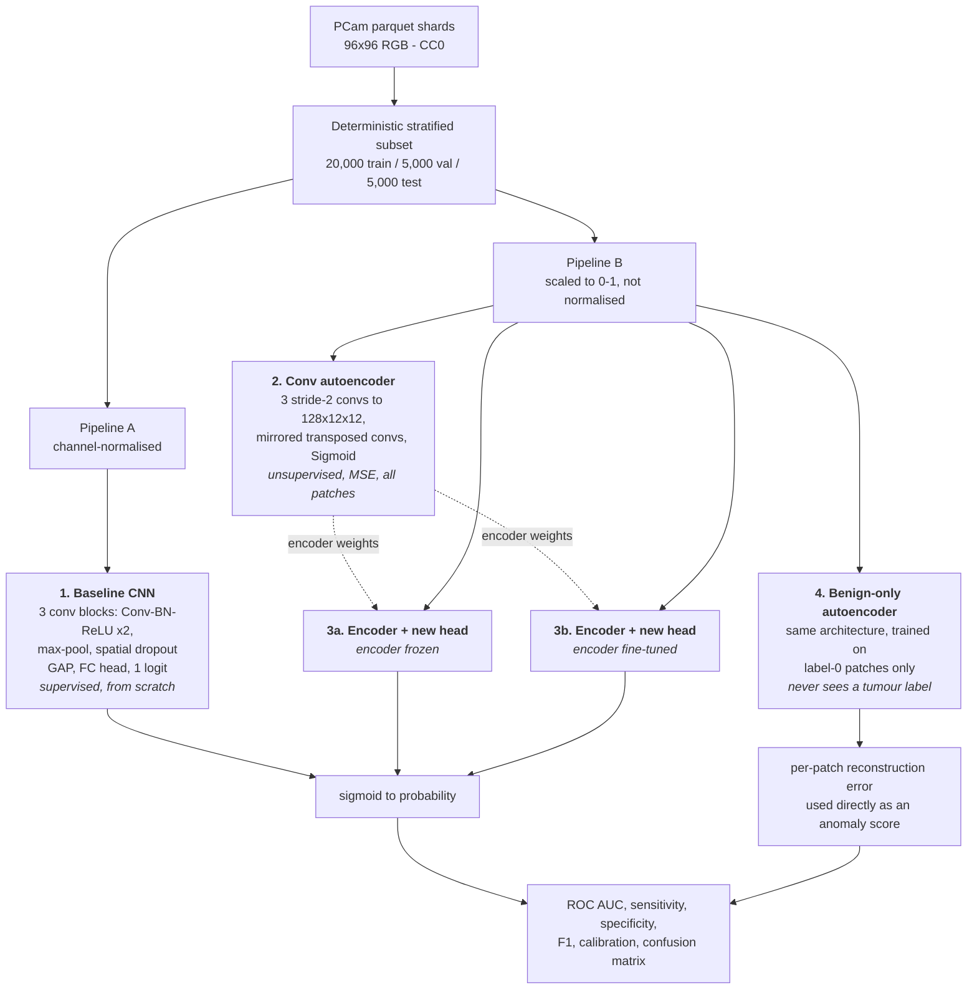
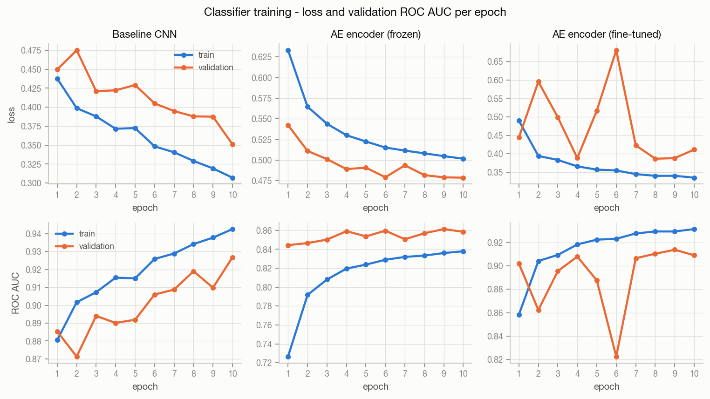
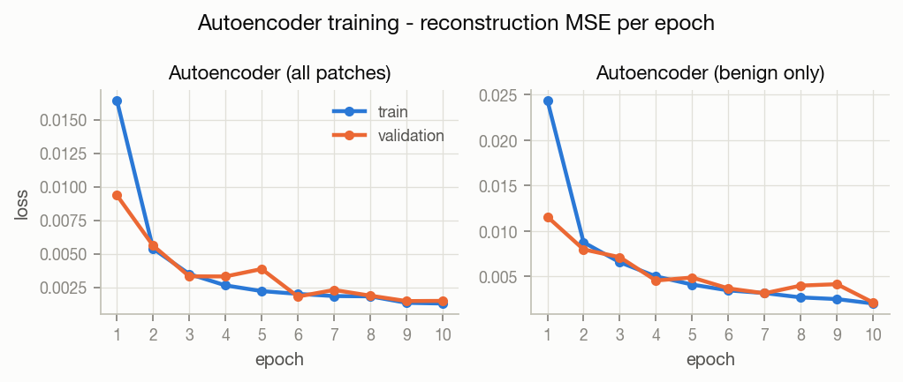
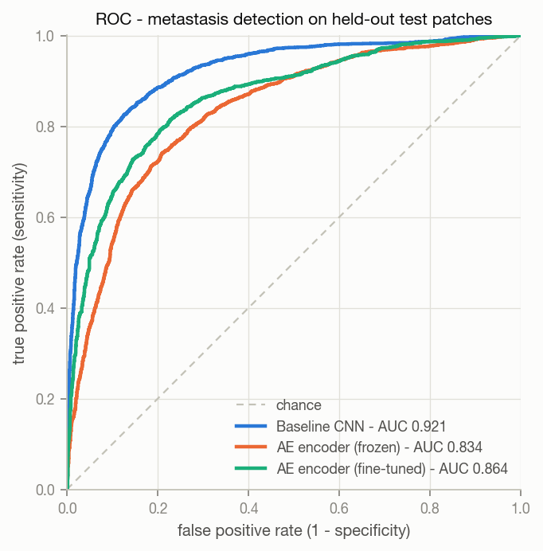
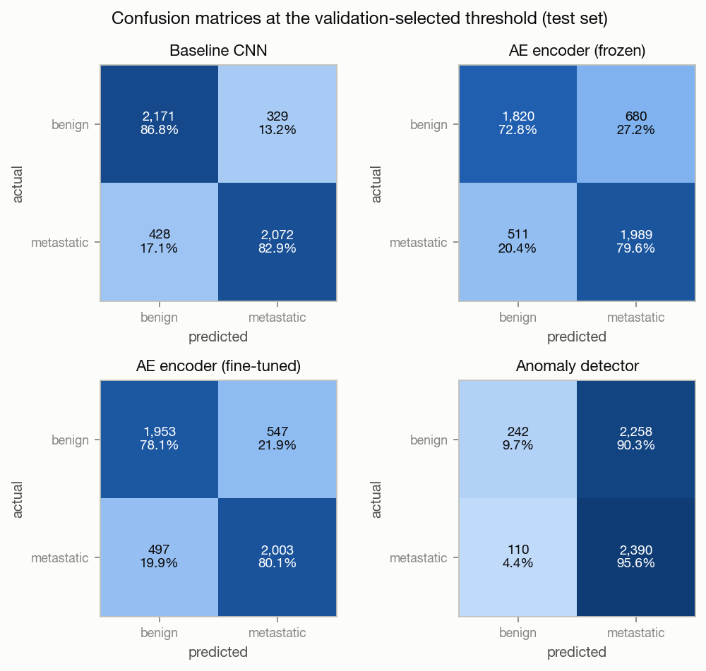
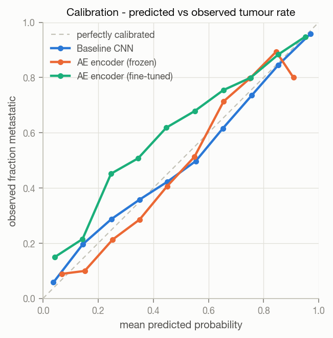
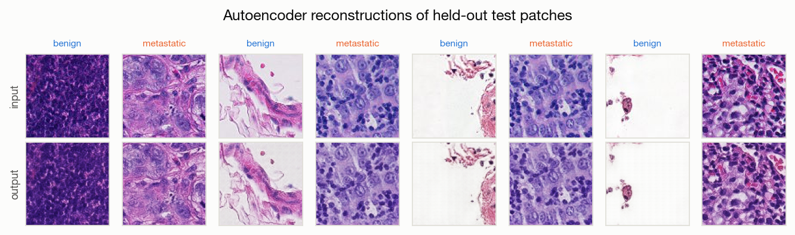
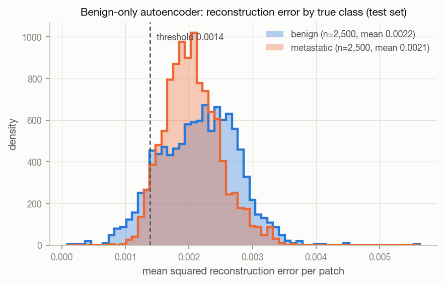
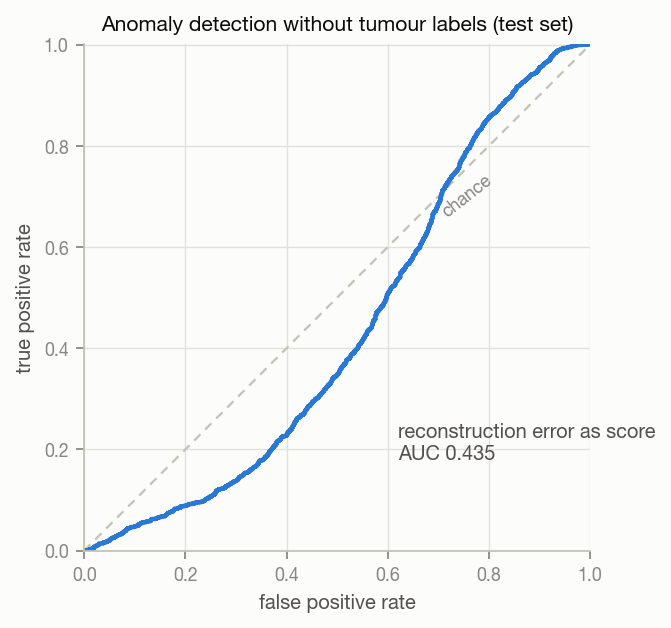
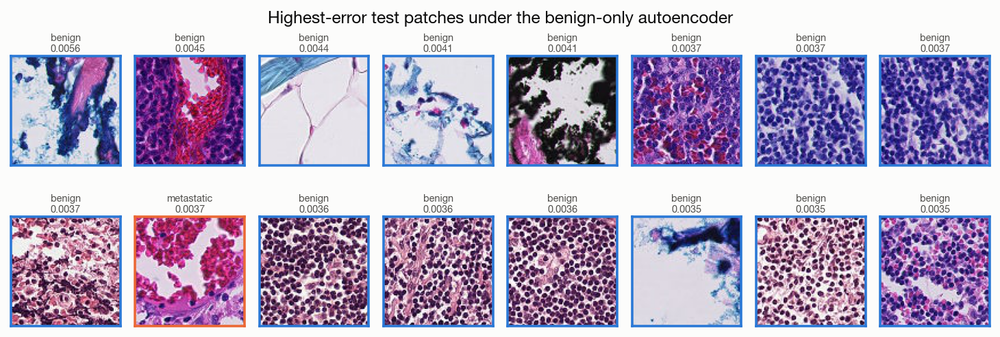

# Detecting metastatic tissue in lymph node histopathology

Four deep learning approaches to the same question — *does this 96x96 patch of
lymph node tissue contain metastatic breast cancer?* — trained, measured and
compared on the public PatchCamelyon benchmark.

The point of the comparison is not to win a leaderboard. It is to ask how much
of the signal survives when labels are taken away: a supervised baseline, an
autoencoder trained with no labels at all, that autoencoder's encoder recycled
into a classifier, and finally a detector that has never seen a single tumour
label and must flag cancer purely as *tissue that does not look healthy*.

**Headline, on 5,000 held-out test patches:** the supervised CNN reaches
**0.9215 ROC AUC**. Unsupervised pretraining does not beat it — a fine-tuned
autoencoder encoder reaches 0.8639 — but it gets most of the way there with a
third of the parameters and a fifth of the training time. The anomaly detector
scores **0.4347**, below chance, because metastatic tissue turns out to be
*easier* to reconstruct than healthy lymph node. That negative result is the
most interesting finding here, and it is explained below rather than hidden.

---

## The clinical problem

When breast cancer spreads, it usually reaches the axillary lymph nodes first.
Staging therefore depends on sentinel lymph node assessment: nodes are excised,
sectioned, stained with haematoxylin and eosin, and examined for metastatic
deposits. A pathologist scans each whole-slide image at high magnification
looking for small clusters of tumour cells in a very large amount of normal
tissue.

The task is slow, visually monotonous and unevenly reproducible. A single node
can occupy gigapixels of image data, metastases can be a few hundred microns
across, and concordance between observers falls as deposits get smaller. This is
exactly the shape of problem where a patch classifier is useful: not to replace
the pathologist, but to triage — to rank regions so that attention goes to the
tissue most likely to matter, and to make it less likely that a small deposit is
missed on a tired afternoon.

That framing also sets the error budget. A false positive costs a few seconds of
a pathologist's time. A false negative potentially understages a cancer. Every
table below therefore reports sensitivity and specificity, not just accuracy.

## The data

**PatchCamelyon (PCam)** — 327,680 RGB patches of 96x96 pixels, extracted from
the Camelyon16 collection of 400 H&E-stained sentinel lymph node whole-slide
images. Each patch carries a binary label: positive if the centre 32x32 region
contains at least one pixel of annotated metastatic tumour tissue, negative
otherwise. Tissue outside that centre region does not affect the label, which
keeps the task well defined under rotation and flipping.

Three details of how PCam was built matter for interpreting any result on it:

- The slides were digitised at two centres with a 40x objective (0.243 µm per
  pixel) and undersampled to 10x to widen the field of view.
- Patches were drawn with **stochastic hard-negative mining**, so the negatives
  are deliberately difficult rather than random background. Absolute accuracy on
  PCam is therefore not comparable to accuracy on an unfiltered slide.
- The official splits are **disjoint at the whole-slide level** — no WSI
  contributes patches to more than one split — and each split is balanced
  close to 50/50.

| | |
|---|---|
| Origin | Camelyon16 challenge, Radboud UMC and UMC Utrecht |
| Benchmark | Veeling, Linmans, Winkens, Cohen and Welling, *Rotation Equivariant CNNs for Digital Pathology*, MICCAI 2018 |
| Reference release | [`basveeling/pcam`](https://github.com/basveeling/pcam) (HDF5) |
| Copy used here | [`1aurent/PatchCamelyon`](https://huggingface.co/datasets/1aurent/PatchCamelyon) on Hugging Face |
| Pinned revision | `e4bd149e7a868a9d811fdd9f9a9fb78c05c104ab` |
| Licence | CC0-1.0 (public domain dedication) |
| Encoding | Lossless PNG inside parquet shards |

### What was actually downloaded

This study keeps PCam's official slide-disjoint splits. To stay laptop-sized,
only the **first parquet shard of each split** is fetched, and a deterministic
class-balanced subset is drawn from it.

That shortcut is only sound if a single shard is representative, so it was
checked rather than assumed. Each shard is internally shuffled and close to
balanced:

| Split | Shard | Rows in shard | Positive rate in shard | Subset drawn | Positive rate in subset |
|---|---|---|---|---|---|
| train | `train-00000-of-00013` | 20,165 | 0.5009 | 20,000 | 0.5000 |
| validation | `valid-00000-of-00002` | 16,384 | 0.5000 | 5,000 | 0.5000 |
| test | `test-00000-of-00002` | 16,384 | 0.5042 | 5,000 | 0.5000 |

Reproduce that table with `python scripts/download_data.py`, which prints it.

Subset selection lives in `histopath.data.stratified_subset_indices` and depends
only on `(labels, n_total, seed)` — not on call order, platform or how many
other draws happened first. The default seed is `20260214`. Channel statistics
are then **measured** from the training subset rather than copied from a paper:

```
channel mean  0.7005, 0.5388, 0.6914
channel std   0.2351, 0.2777, 0.2134
```

The pink-purple cast of H&E staining is visible in those numbers: the red and
blue channels sit far above green.

Image data is **not committed**. It is cached under `data/` (git-ignored) by a
one-command download script, and each shard's SHA-256 is verified on fetch.

## The four approaches



**1. Baseline CNN, supervised from scratch.** Three VGG-style blocks (two 3x3
convolutions, batch norm, ReLU, max-pool, spatial dropout) take 96x96 down to
12x12; global average pooling and a small fully connected head emit one logit.
This is the reference point every other model is judged against.

**2. Convolutional autoencoder, unsupervised.** The same patches with the labels
thrown away. Three stride-2 convolutions compress to a 128x12x12 latent map and
mirrored transposed convolutions reconstruct the patch, trained on mean squared
error. Because the decoder ends in a `Sigmoid`, this pipeline scales inputs to
`[0, 1]` and does *not* standardise them.

**3. Transfer learning, frozen and fine-tuned.** The trained encoder is lifted
out and given a fresh classification head, twice. Frozen, it answers "are
features learned purely from reconstruction already linearly useful for
diagnosis?" Fine-tuned, it answers the different question "is reconstruction a
useful *initialisation*?" Both variants are trained and scored on the same
`[0, 1]` scale the encoder was pretrained on, so the comparison is not
confounded by a shifted input distribution.

**4. Anomaly detection with no tumour labels.** An autoencoder is trained on
**benign patches only**, so it learns to reconstruct healthy lymph node
morphology and nothing else. Every test patch is then scored by its
reconstruction error and thresholded. This is the strictest condition in the
study: the model never sees a positive label, during training or threshold
selection on the benign quantile rule. Reconstruction error is a pure ranking,
so it is judged first by ROC AUC and only then at a chosen operating point.

### Honest about thresholds

ROC AUC is threshold-free, but every other metric is not, so the threshold has to
come from somewhere defensible. All thresholds here are selected on the
**validation** split and applied unchanged to the test split:

- `default_0.5` — the conventional probability cut, for reference.
- `val_youden` — maximises sensitivity + specificity - 1 on validation.
- `val_benign_p95` — anomaly detector only: the 95th percentile of benign
  validation reconstruction error, a rule that needs no tumour labels at all and
  so is the one honestly available in the unsupervised setting.

Nothing in this repository tunes a threshold on the test set.

## Results

All numbers below are measured on the 5,000-patch test split by the committed
run, and are reproduced verbatim from `results/metrics.csv`. Nothing is quoted
from a paper and nothing is rounded in our favour.

The run is deterministic: every RNG is seeded from `--seed`, and re-running the
whole study on the same machine reproduced these figures exactly.

### Headline — test set, threshold selected on validation (Youden's J)

| Model | ROC AUC | Accuracy | Sensitivity | Specificity | Precision | F1 | Brier | ECE |
|---|---|---|---|---|---|---|---|---|
| **Baseline CNN** (supervised, from scratch) | **0.9215** | 0.8486 | 0.8288 | 0.8684 | 0.8630 | 0.8455 | 0.1098 | 0.0216 |
| AE encoder, fine-tuned | 0.8639 | 0.7912 | 0.8012 | 0.7812 | 0.7855 | 0.7933 | 0.1589 | 0.0902 |
| AE encoder, frozen | 0.8341 | 0.7618 | 0.7956 | 0.7280 | 0.7452 | 0.7696 | 0.1672 | 0.0471 |
| Anomaly detector (no tumour labels) | 0.4347 | 0.5264 | 0.9560 | 0.0968 | 0.5142 | 0.6687 | - | - |

Brier score and ECE are blank for the anomaly detector because reconstruction
error is a ranking, not a probability.

### Every operating point

| Model | Threshold rule | Threshold | ROC AUC | Accuracy | Sensitivity | Specificity | F1 | TN | FP | FN | TP |
|---|---|---|---|---|---|---|---|---|---|---|---|
| Baseline CNN | `default_0.5` | 0.5000 | 0.9215 | 0.8488 | 0.8520 | 0.8456 | 0.8493 | 2114 | 386 | 370 | 2130 |
| Baseline CNN | `val_youden` | 0.5692 | 0.9215 | 0.8486 | 0.8288 | 0.8684 | 0.8455 | 2171 | 329 | 428 | 2072 |
| AE encoder (frozen) | `default_0.5` | 0.5000 | 0.8341 | 0.7604 | 0.7836 | 0.7372 | 0.7658 | 1843 | 657 | 541 | 1959 |
| AE encoder (frozen) | `val_youden` | 0.4874 | 0.8341 | 0.7618 | 0.7956 | 0.7280 | 0.7696 | 1820 | 680 | 511 | 1989 |
| AE encoder (fine-tuned) | `default_0.5` | 0.5000 | 0.8639 | 0.7796 | 0.6728 | 0.8864 | 0.7532 | 2216 | 284 | 818 | 1682 |
| AE encoder (fine-tuned) | `val_youden` | 0.2781 | 0.8639 | 0.7912 | 0.8012 | 0.7812 | 0.7933 | 1953 | 547 | 497 | 2003 |
| Anomaly detector | `val_youden` | 0.0014 | 0.4347 | 0.5264 | 0.9560 | 0.0968 | 0.6687 | 242 | 2258 | 110 | 2390 |
| Anomaly detector | `val_benign_p95` | 0.0030 | 0.4347 | 0.4804 | 0.0320 | 0.9288 | 0.0580 | 2322 | 178 | 2420 | 80 |

### Cost of each model

| Model | Parameters | Trainable | Epochs | Best epoch | Best validation score | Train time |
|---|---|---|---|---|---|---|
| Baseline CNN | 295,777 | 295,777 | 10 | 10 | AUC 0.9268 | 869 s |
| Convolutional autoencoder | 186,691 | 186,691 | 10 | 9 | MSE 0.0015 | 253 s |
| AE encoder (frozen) | 101,793 | **8,321** | 10 | 9 | AUC 0.8613 | 154 s |
| AE encoder (fine-tuned) | 101,793 | 101,793 | 10 | 9 | AUC 0.9137 | 213 s |
| Anomaly autoencoder (benign only) | 186,691 | 186,691 | 10 | 10 | MSE 0.0021 | 132 s |

Wall-clock times are from the committed run and are the one quantity that moves
between runs on a shared laptop; the metrics above do not.

### Reading the results

**Supervised learning wins on accuracy, and it should.** The baseline CNN has
direct access to 20,000 labels and the most parameters, and at 0.9215 AUC it
beats everything else. At its operating point it misses 428 of 2,500 metastatic
patches — a 17% false negative rate, which is the number that would matter
clinically and is far too high for autonomous use.

**Unsupervised pretraining buys efficiency, not accuracy.** The frozen encoder
is the strict test: with the encoder locked and only **8,321** trainable
parameters in the head, features learned purely by reconstruction still reach
0.8341 AUC. Reconstruction therefore does capture diagnostically relevant
structure — nuclear density, chromatin texture, stromal pattern — without ever
being told what cancer is. Unfreezing adds 0.03 AUC on top.

The efficiency story is clearer than the accuracy story. The fine-tuned encoder
reached 0.902 **validation** AUC after a single epoch; the baseline CNN needed
six epochs to match that, and ten to pass it. The transfer model also carries a
third of the baseline's parameters and trained in 213 seconds against 869.
That is the honest trade: for roughly a quarter of the fine-tuning compute you
get about 94% of the baseline's AUC. The caveat is that the autoencoder's own
253 seconds of pretraining must be paid once; counting it, the two routes cost
about the same here, and transfer only pays off when that pretrained encoder is
reused — across several downstream heads, or on a large pool of unlabelled
slides that no supervised model could exploit at all.

**Calibration.** The baseline is the best calibrated (ECE 0.0216); the
fine-tuned encoder is the worst (ECE 0.0902), and its default 0.5 threshold is
badly placed — sensitivity 0.673 at 0.5 against 0.801 at the validation-selected
0.278. This is exactly why the threshold is chosen on validation rather than
assumed.

**The anomaly detector fails, and the direction of failure is informative.**
Trained on 10,000 benign patches only, it reaches 0.4347 AUC on test — not near
0.5, but *below* it, and reproducibly so (0.4232 on validation). Mean
reconstruction error is **0.00216 for benign** patches against **0.00206 for
metastatic**, a ratio of 0.95. Metastatic tissue reconstructs slightly *better*
than the healthy tissue the model was trained on.

The error histogram shows why this is not a bug. Benign lymph node is dense,
high-frequency texture: a dark, crowded field of small lymphocyte nuclei. A
small convolutional autoencoder blurs exactly that kind of fine detail, so
healthy tissue incurs a relatively high reconstruction penalty. Metastatic
deposits are comparatively low-frequency — larger, more uniform epithelial
cells with more pale stroma — which a blurry decoder reproduces more faithfully.
The score ends up tracking *spatial frequency*, not pathology.

The practical lesson is that "anomalous" is defined by whatever the model finds
hard to compress, and that need not coincide with "diseased". The distributions
overlap almost completely, so neither threshold rule rescues it: Youden's J
degenerates to flagging nearly everything (95.6% sensitivity, 9.7% specificity)
and the benign 95th-percentile rule to flagging almost nothing (3.2%
sensitivity). A reconstruction-error detector is the wrong instrument for this
task at this scale, and inverting the sign would be curve-fitting to the test
set rather than a finding.

## Figures

### Training





### Discrimination







### What the autoencoder learned



### Anomaly detection without tumour labels







The highest-error grid is the clearest single piece of evidence for why the
anomaly detector fails. Fifteen of the sixteen worst-reconstructed test patches
are **benign**. They are not subtle: blue surgical ink, adipose tissue, near-empty
fields of fat and capsule, and dense sheets of lymphocyte nuclei. The detector
is faithfully flagging the unusual — it is simply that in a lymph node, the
unusual is artefact and fat, not cancer.

## How to run

Python 3.12. CPU-only works; Apple `mps` is used automatically when PyTorch
reports it available.

```bash
git clone https://github.com/itsgichia/histopath-metastasis-cnn.git
cd histopath-metastasis-cnn

python3.12 -m venv .venv
source .venv/bin/activate
pip install -r requirements.txt

# Fetch the PCam shards and build the decoded subset caches (git-ignored).
python scripts/download_data.py

# Train everything, write results/*.csv and figures/*.png.
python scripts/run_all.py
```

**Runtime.** The committed run took **27.6 minutes** end to end on an Apple M1
with 8 GB of unified memory, using the `mps` backend, while the machine was also
running an unrelated workload. Over half of that is the baseline CNN (869 s);
the other four stages together take about 750 s. An earlier, identical run on
the same machine under heavier memory pressure took 37.4 minutes, so treat
these as the range rather than a fixed figure. Use `--epochs 6` to roughly
halve it. Downloading the three parquet shards (~1.2 GB) and decoding the
subset caches is a separate one-off cost of a few minutes.

Smaller and larger runs:

```bash
python scripts/run_all.py --epochs 2 --subset 2000      # smoke test, ~3 min measured
python scripts/run_all.py --epochs 25                   # longer training
python scripts/run_all.py --device cpu                  # force CPU (slow, see below)
python scripts/run_all.py --checkpoints checkpoints/    # also save weights
```

On the same M1, CPU training measured roughly an order of magnitude slower than
`mps` for the baseline CNN, so `--device cpu` is best paired with a reduced
`--subset` and `--epochs`.

Tests:

```bash
pytest -q                                               # whole suite
pytest tests/test_anomaly.py -v                         # one file
```

## Repository layout

```
histopath/
  data.py        download, pinned revisions, deterministic subsets,
                 dataset classes, three transform pipelines
  models.py      BaselineCNN, ConvAutoencoder, EncoderClassifier
  train.py       training loop, early stopping, LR scheduling, history
  evaluate.py    accuracy, ROC AUC, precision/recall/F1, confusion, calibration
  anomaly.py     benign-only scoring, thresholds, error AUC and summaries
  plots.py       figure generation on one validated palette
scripts/
  download_data.py   one-command fetch and cache build
  run_all.py         trains everything, writes results/ and figures/
tests/             pytest suite
results/           committed CSV outputs of the run described above:
                   metrics.csv, model_summary.csv, training_history.csv,
                   anomaly_error_summary.csv, anomaly_test_scores.csv,
                   dataset_summary.csv, run_metadata.csv
figures/           committed PNG figures of the same run
data/              git-ignored cache of shards and decoded subsets
```

## Limitations

These matter more than the numbers, and none of them are hypothetical.

- **Patch level, not slide level.** Clinical staging is a statement about a
  node, not about a 96x96 crop. Turning patch scores into a slide-level call
  needs spatial aggregation across a whole-slide image, which is not attempted
  here. The reported metrics do not translate into slide-level performance.
- **Small subset.** 20,000 of 262,144 available training patches, from a single
  parquet shard. Published PCam results train on the full split and reach higher
  AUC; these numbers are a like-for-like comparison *between the four approaches
  under one fixed small budget*, not an attempt at state of the art.
- **No stain normalisation.** H&E colour varies substantially between
  laboratories, scanners and staining batches, and Camelyon16 itself was
  digitised at two centres. No Macenko, Reinhard or Vahadane normalisation is
  applied, and augmentation is restricted to flips and quarter turns. A model
  trained this way is expected to degrade on slides from an unseen laboratory.
- **Hard-negative mining inflates difficulty, not realism.** PCam's negatives
  were selected adversarially, so these numbers do not transfer to a workflow
  that must also reject the vast majority of easy background tissue on a real
  slide.
- **No external validation.** Train, validation and test all come from
  Camelyon16. There is no second cohort, no second scanner and no second
  institution, so nothing here speaks to generalisation.
- **The baseline had not converged.** Its validation AUC was still rising at the
  10-epoch cap (see the training curves), so 0.9215 is a floor on what this
  architecture can do, not a ceiling. The epoch budget was chosen to keep the
  whole study runnable on a laptop, which means the comparison is "four
  approaches under one fixed budget" rather than "four approaches at their
  best". A longer run would most likely widen the gap in the baseline's favour.
- **Single run, no confidence intervals.** One seed per configuration. Reported
  differences between the models are not accompanied by uncertainty estimates
  and small gaps should not be over-read. The anomaly result is the exception
  worth trusting: it reproduced in the same direction on both validation
  (0.4232) and test (0.4347).
- **Centre-crop label semantics.** A patch is positive if tumour appears in its
  centre 32x32 region, so a patch with tumour only at its edge is labelled
  negative by construction. Some apparent errors are this convention, not model
  failure.
- **Reconstruction error is not calibrated.** The anomaly score is a ranking.
  Its Brier score and calibration error are meaningless and are reported as
  blank rather than as a number.
- **Not a diagnostic device.** This is a methods study on public, de-identified
  research data. It is not validated, regulated or approved for clinical use,
  and must not be used to inform the care of any patient.

## Licence

Code released under the MIT Licence — see [LICENSE](LICENSE).
PatchCamelyon is CC0-1.0; the Camelyon16 data it derives from is released for
research use by the challenge organisers.

## Author

**Gichia Muiruri** — MSc Health Data Science, UNSW Sydney

- LinkedIn: https://www.linkedin.com/in/gichia-muiruri
- GitHub: https://github.com/itsgichia
